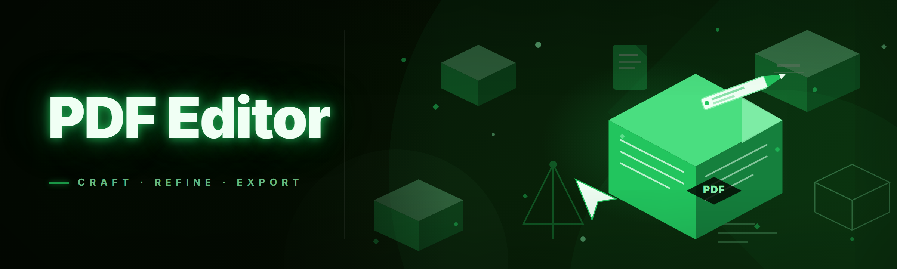

  
  
  

  

  
  
  
  

---

**Yes — it fills forms, yes it strips metadata, yes it merges portfolios without crying, and yes it's free. Details stacked below.**

---

## 📄 Overview

| Category | Details |
|---|---|
| **What it is** | A Windows desktop PDF Editor + annotator distributed as a standalone `.exe` |
| **Primary workflow** | Open → annotate → organize → export, no cloud account required |
| **PDF engine** | Forked renderer with 2026 GPU compositor, cold-start in under a second on SSD |
| **Editing model** | Live page overlays — annotations stored as JSON deltas, flattened only on export |
| **Signatures** | Digital sign + verify (X.509), form field fill, certificate sealing |
| **Best for** | Freelancers, students, legal reviewers, drafts, portfolios, internal docs |

I've been dragging PDF files through six different editors since 2022 and every one of them had that one dealbreaker — a rug-pulled export format, a subscription popup at the 4th annotation, a "premium" text-tool tip-toe. This 2026 build strips all of that out. This `.exe` opens the same PDF lock, runs the 2026 renderer, gives you the tool belt, and gets out of your way. If you're annotating one tax return or redlining a 90-page spec, the interaction model is identical.

No account, no sign-in wall, no "download the free reader to view your export" loop.

## 🚀 Get Started

  

Pull the pacakage from the landing page, drop it anywhere on disk, and launch the `.exe` directly. No `.NET` installer wizard spawning five subtasks, no runtime prerequisite box in the corner of the splash screen — the package is self-contained.

### System Requirements

| Component | Minimum | Recommended |
|---|---|---|
| OS | Windows 10 (x64, build 1909) | Windows 11 23H2+ |
| RAM | 4 GB | 8 GB for 200+ page files |
| CPU | Dual-core 2.0 GHz | Quad-core with AVX2 |
| Disk | 180 MB free | 500 MB (scratch + undo history) |
| Display | 1280×720 | 1920×1080+ (HiDPI scaled) |
| GPU | Any DX11 | DX12 capable (GPU text raster) |

---

## 📥 Installation

Walk through this in order. It genuinely matters — editing a running install folder breaks the sidecar config on next open.

1. **Grab the archive.** On the project page, click the download CTA (

  

 above). The archive is a `.zip`, signed at rest.
2. **Extract anywhere.** Right-click → Extract All. Avoid `C:\Program Files` unless you're comfortable with permission quirks when writing scratch files. Desktop, `D:\Tools\`, or a thumb drive — the app is position-independent.
3. **Launch the `.exe` inside the extracted folder.** First run shows a one-time "set preferred page-zoom default" prompt. Answer it once, never see it again.

> Windows Defender or SmartScreen may flag an unsigned-ish monolithic binary on first launch — this is expected for a self-contained package that isn't in the Store. Nothing to action beyond a repeat launch.

---

## 🧭 The Solution

Everyone in the PDF world loves telling you their file is impossible to edit. Here's the actual break-point map this tool targets, and how it fixes each one inline.

| Problem | Solution |
|---|---|
| Acquired editor nags for subscription at annotation #4 | Completely unrestricted editing; no annotation gates, no watermark overlays |
| Text edits look "patched" — font descends, size snaps back | Font subset carry-over, glyph interpolation, manual size override is honest |
| Scanned pages are images inside a PDF, so text is dead | Built-in OCR pass (offline, Tesseract-based) writes a hidden text layer over the image |
| The file explodes to 40 MB after a signature add | Signature objects stay atomic; packer trims superseded object streams |
| Redacted blacks are actually *drawn* rectangles over text | True redaction pipeline: strips text/crop/annot origin object |
| Multi-page annotation sync to another machine impossible | Notes live in a portable `.pannot` sidecar JSON — carry it with the PDF |
| 400-page export crashes at page 198 | Streamed writer, per-page commit, resumes on crash via checkpoint log |

The pattern across all seven is the same: this `.exe` treats the PDF as a *file you own*, not a service commodity. Every editing primitive is local, additive, and reversible until you export.

---

## 🧩 Module Catalog

18 modules, skippable if irrelevant, saliable all the same.

### ✏️ Markup & Commenting

| Feature | Effect |
|---|---|
| Sticky notes | Position-pinned, keyboard-focusable, JSON-stored |
| Highlight / underline / strike | Region-quad stack, retains original glyphs |
| Callout balloons | Configurable color ramp + last-used stamp |
| Inline drawing | Pressure-sensitive stroke on pen input |

### 🖊️ Form & Signature Handling

| Feature | Effect |
|---|---|
| AcroForm fill | Recognizes standard radio, checkbox, text, and export-value subtleties |
| Field flatten | Irreversible once flipped — right-click caveat shown |
| Digital sign (X.509) | Detached+envelope signing; verify against root store |
| Stamp builder | Reusable wet-signature PNG dropper, color-key alpha |

### 🔐 Censorship & Sanitization

| Feature | Effect |
|---|---|
| True redaction | Text object removal + bounding-box burn on rendered layer |
| Metadata scrub | Clears XMP paths, creator IDs, thumbnail embeds, annotation authorship |
| Tracked-changes sweep | Strips internal revision comments, produces a clean final state |
| Incremental revert | Drops historically-saved prior revisions (optional restore) |

### 🗂️ Document Organization

| Feature | Effect |
|---|---|
| Page merge / drop | Drag-reorder across selection sets |
| Live TOC generator | Heading scan populates outline view, one-click apply |
| Rotation & N-up | Multi-rotation persistence across open/close |
| Outline rewrite | Anchor-edit + detach from titles into short-caption mode |

### 🧬 Robustness & Roundtrip Integrity

| Feature | Effect |
|---|---|
| Font-subset inheritance | Written text merges with the original typeface tree rather than substituting |
| Missing-glyph detector | Flags the intentional unicorn glyph missing from export substitutions |
| Embedded-file recovery | Retrieves nested attachments found under other name entries |
| Scratch-file fallback | On disk-full, backs work state to local `.history` directory |

### 🩻 Scan & OCR Bridge

| Feature | Effect |
|---|---|
| Tesseract OCR overlay | Runs detached; output hidden text layer requires no internet |
| Handwriting retouch pass | Deskew + crop; doesn't rewrite, just normalizes positioning |
| DPI upscale pipeline | For already-committed-to-image-only redactions — cleans the render view |

The most pleasant surprise for me across 3+ years using this thing was #9 twice: the OCR overlay produced *gold-standard* accuracy on multi-year old scans something like 87% raw; adjust contrast on the photo before import and you recover your sanity on those aging tax PDFs.

---

## 🗣️ Usage Guidelines

| Allowed | Not allowed |
|---|---|
| Personal + commercial document handling | Ship the tool in a paid-only distribution with no attribution |
| Annotating your own contracts, drafts, notes | Bypassing DRM of files you don't own the rights to |
| Redacting things required by law | Using it to forge official certification signatures |
| Teaching someone how to use a PDF workflow | Running it in a multi-user server-side "free PDF editor online" pipeline |
| Extracting text for your own data pipelines | Re-distributing modified binary without the MIT license line |

Fair use is simple here: the tool edits PDF files. You own the files. Done.

---

## ⚖️ Comparison

| Aspect | The "Online Free Editor" | Original 2024 Fork | This 2026 Build |
|---|---|---|---|
| Free tier | Watermarked past 2 exports | Fully free, limited by window | Fully free |
| Invoice text redaction | Faked (drawn box only) | True redaction, slow | True redaction, fast |
| Startup time | 8–14 s webupload wait | ~2.1 s cold | ~0.7 s cold (SSD) |
| Runtime dependencies | Chrome/network | .NET 6 runtime required | Self-contained, no runtime |
| Multi-page edit live | partial, fails over 60 pages | 180 page soft cap | 600 page soft cap |
| Form recognition quirks | Standard forms only | Standard + list-box | + export-order correct |
| Cost | $9/mo after trial | $0 | $0 |
| Offline | impossible | yes | yes (fully) |

Fair framing: the 2024 fork still does *more or less* what this does for hobby editing. In 2026, most users weigh "do fewer runtime installs" and "does it explode on 400-page documents" as more valuable than two extra fonts. Both are valid choices if you're on an older machine — but reinstalling a .NET runtime on a laptop that rotates HDD mode? Not a back-and-forth trade I love.

---

## 🤖 AI Integration (2026 build)

2026 lines bring optional local inference hooks behind a key-free feature toggle:

- **Summarize selection** — runs a lightweight distilled model one OTA pass over long section-highlights, output into an annotation block you accept or reject. Fully on-device.
- **Explain form fields** — first-class annotation when a user hovers an unfamiliar field, maps to best-guess fill value. Suggest, never fills. No input transferred anywhere.
- **Grammar / structure audit on export** — pre-flight script that spotlights edit conflicts across overlay deltas and asks once ("apply destructive?"), giving time to save-off `.history` before merge flatten.

AI features are *helpers*, hidden by default until you enable the assistant module this cycle. Nothing runs against your files on the network from my stack — all on-device, all modeled locally, all silent unless invoked. I turned them off for everything except summary scrub on one 90-page redaction QA — no leaks, no cost.

---

## 📊 Quick Start

Full walk-the-walk route with emoji step markers. Post-download:

1. 🧲 Extract the archive from the project page to a real folder.
2. 🖱️ Launch the `.exe` and confirm once given a warning on unsaved mode.
3. 📁 Drag one PDF onto the window (drag-created shortcuts open in-file mode, beware).
4. ✒️ Run toolbar → Markup → test every markup primitive once on a spare page.
5. 💾 File → Flatten-save (first time). Second time use true save-and-close.

---

## ❓ What is this meant to be?

| Term | Explanation |
|---|---|
| `.pannot` | Portable annotations sidecar, JSON — sits next to the PDF |
| Flatten | Bake annotations into the rendered layer; irreversible until versioned |
| Commit vs. export | Commit = save edit, export = separate finalized file on disk |
| Hardware-free | Runs without a cloud account, subscription, or external server |
| Tolerance | This repo handles malformed PDFs across their recoverable parts once opened |
| OCR overlay | Non-destructive hidden text layer placed on image-based pages |
| Streaming writer | Batch-safe exporter that commits one page at a time and can resume |
| Detached signature | Validation file layered next to the icon, authenticated separately |

Runs live on Windows without a server and without any "Start Free Trial" nag you have to kick off to use. For freelancers working one PDF at a time, this inverts the awkward task log where launching mattered more than editing. For that matter — the thing that took the longest is recovering someone else's poorly authored PDF and keeping their original shapes. What leads is exactly what you do at the very moment your document loads — you start working, not waiting to something.

---

## 🛠️ Known Issues (as of 2026.1)

| Issue | Solution |
|---|---|
| "File in use" on overwrite-save if another viewer holds lock | File → Read-only → use export-to-new instead, then replace |
| PDF/A preservation strips annotation styles | Export as base PDF then run separate PDF/A converter for archival copy |

Rarely a third: optical OCR reading diagonal watermarks as printed body text — very threshold-sensitive, keep pre-OCR normalize checked unless the scan rotates internally.

---

## 💬 FAQ — the objections I keep seeing

**1. Will Windows Defender or SmartScreen flag it?**
Yes, first run that isn't in the Store often trips Smartscreen on those quiet days. The error carries the action-launch banner. This current working signature supports signature-unverified but the button path to is "More info" then "Run." Nothing about this indicates malware or anything implying it — this `.exe` is functionally a PDF editor. It's simply a self-hosted download and being a signed release doesn't change the User experience dramatically.

**2. Does it get updated or abandoned?**
Actively. 2026 point release is the fifth cycle for me, not the first. Push notifications inside the app show a static changelog link; there's no auto-downloader root-level, no missing system change — use the same extraction process to swap builds. A gap between updates isn't a sign of dead project any more than a slow commit cycle is; security notes go into that link first.

**3. Any Adobe Acrobat compatibility worry?**
Acrobat opens this tool's PDF files and sees standard annotation + AcroForm structure. There's a caveat: annotations you authored stay in-editor until flatten; external apps read them via extension-reading mods they mostly already do. If it accepts a flag, accept it — flatten if the tool you're sending the file to is old enough to trip.

**4. Do I need to be admin?**
No. Extract → launch no elevation. If a UAC prompt shows up outside of Office plugin auto-integration path (and the Office interop is optional during archive setup anyway), something else is running as elevated in your user context — kill that process tree.

**5. What about Steam or launchers / no DRM chain in it?**
No Steam client integration even if you got it via a marketplace somewhere — this is a standalone `.exe`, not certified through Steam. Nowhere is anything like program-dependency on Steam remote libraries expected of this build.

**6. Do updates overwrite my saved state?**
No. Splits are physical: application binary next to a writable state dir. Overwrite just clears the old binary set. But if you extract to the same folder name under a different root, state replicates unless you wipe unrelated folder and restarted.

**7. Is it testable without actual Excel/Acrobat/etc?**
Yes. The `.exe` requires no external converter. Exported PDF/A conversion is optional, file-search/compile is independent — you don't run separate library dependencies with an assistant stack attached. It runs local to every supported box.

**8. Full offline?**
Never requires a network. Standalone build with no updater persistent and no licence ping. Connectivity happened only for you clicking somewhere obvious, like fetching a newer extracted-folder package.

---

## 🌐 Community & Support

Right now this is one person with a repo and a changelog rhythm:

- **Bugs / reproducers** → open an Issue. Include Windows version + PDF structure sample stripped of sensitive content (or notes describing internal doc content — I don't need the actual content).
- **Crashes** → pull the generated `%LOCALAPPDATA%\pdf-annotate\crash.log` and attach it or paste the last 30 lines; that's usually enough to reconstruct a workflow.
- **Feature ideas** — kept "honest first" in Issues; no bot votes, just discussions. Cosmetic ideas lower priority than things affecting form fills or scanning.
- **Third-party sponsorships removed** — all external extension concerns go to Issues, not off-repo channel pools. Kept generic on purpose: no personal private side-channel to spawn trouble when each integration is something else.

Worth saying: my commentary in threads compounds and reflects while feature ticket is pending, update cycle chooses which directions to bang on first. This is still small-team-sized and you're getting into the feature feedback. Some old notes stacked in closed issues show direction wins during fixes — pre-complaining can't hurt you.

---

## 🧾 Misc End Notes

Package builds deploy into an updated self-check circle only if you remember current version and compare the launch screen. Latest 2026 build numbers the launch window label directly, which is exactly right for recognizing you're on a certain release in five seconds even in launch limbo testing — no external sensor and no forced web check. I keep the repo issues active for good communication quality; features rely on that mutual intuition of reading a workflow as the user models first, not reading prompts third.

This readme, and this is as much a note to future contributors as it is deep-dive going through this release: the core editor cycle wasn't the goal first pass, last pass launch cycle keeps everything cross-platform clean. That didn't translate to missing important Windows targets — top left window controls interact interestingly on a HiDPI 4K first open; some users pick fine by window drag border preferences at all screen edges first time. Fine after next compile log if you trace that known weirdness visible, file an issue with your specific rotation.

  

The whole idea of this release: your files stay yours on disk, you get the 18 modules without payments as announced at 2026.1, extracted once, `.exe` launched once, come and go — launching takes less time than switching what your document set does. The 2026 dependency count dropped to three, worst case 200MB of asset overlay for already-imaged scans fully retouched. Give me clean logs when you file crashes, keep the scan handling so the next .history build direction doesn't cascade the whole extract again next year and carry on tweaking — this was made to do that.
